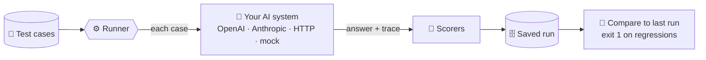
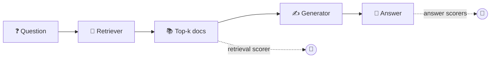
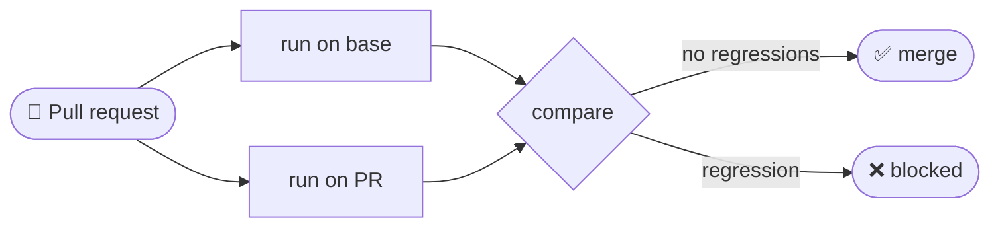
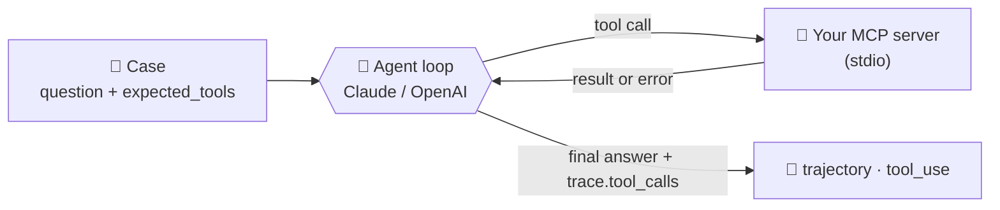

<div align="center">

# 🧪 ai-eval

### Test your LLM apps the way you test your code.

**Offline evaluation runner for LLM, RAG and agent systems** —
test cases in, scored runs out, regressions caught before they merge.

[](https://github.com/Dhillon001/ai-eval/actions/workflows/ci.yml)


<br/>


</div>

---

## 💡 The problem

Changing a prompt, swapping a model, or adding documents to a knowledge base can **silently break answers that used to work**. Eyeballing a few chats won't catch it.

**ai-eval** turns "does it still work?" into a repeatable test: write the questions and expected answers once, run them after every change, and block the change if something got worse.

---

## 🧭 How it works



1. **Write test cases** — a question plus what a good answer looks like.
2. **Run** them through your AI system.
3. **Score** every answer.
4. **Compare** with the previous run and flag anything that got worse.

---

## 🔍 RAG can fail in two places

A RAG system first **retrieves** documents, then **generates** an answer from them. Either step can break, so ai-eval scores them separately and a failure points at the step that caused it.



| step | what can go wrong | how it's scored |
|---|---|---|
| Retrieval | It fetched the wrong documents | `retrieval` |
| Generation | It had the right documents but still answered badly | `checklist`, `llm_judge`, `faithfulness` |

---

## 🎯 Scorers

| scorer | what it checks | example |
|---|---|---|
| `exact` | the answer equals the expected text | expected "30 days" |
| `checklist` | the answer contains required words | must mention "refund" and "30 days" |
| `llm_judge` | another LLM grades the answer | "is this a correct summary of the policy?" |
| `faithfulness` | every claim is backed by the retrieved documents | no made-up facts |
| `retrieval` | the right documents came back, ranked high | see below |
| `trajectory` | an agent called the right tools | looked up the order before refunding |
| `tool_use` | an agent used tools accurately and efficiently (precision, recall, invalid args, extra calls) | no malformed or wasted calls when checking stock |

A case passes only if **every** scorer passes.

**Retrieval metrics:**

| metric | meaning |
|---|---|
| `recall@k` | what fraction of the right documents are in the top k results |
| `hit_rate` | is at least one right document in the top k? |
| `mrr` | how high the first right document is ranked (1st = 1.0, 2nd = 0.5, 3rd = 0.33) |

---

## 🧪 Example: catching a bad change

A support bot answers questions from five documents. The team re-chunks them, and ai-eval compares the runs before and after:

| question | right documents | before | after the change |
|---|---|---|---|
| "How long do I have to return an item?" | `policy-returns` | ✅ found | ✅ found |
| "Can I return a final-sale jacket?" | `policy-returns`, `policy-final-sale` | ✅ both found | ❌ `policy-returns` missing |
| "Do you ship to Canada?" | `faq-shipping-intl` | ✅ found | ❌ not found |
| "Where is my order A1001?" | agent calls the right tools | ✅ | ✅ |

**Result:** pass rate drops from 4/4 to 2/4. The answer-text checks did not change, but both retrieval scores dropped, so the problem is the **retriever**, not the prompt or the model. `compare` exits with code 1 and CI blocks the merge.

---

## 🚦 CI regression gate

On every pull request, GitHub Actions runs the tests on the main branch and on the PR, compares the two, and blocks the merge if anything regressed.



---

## 🚀 Quick start

No API key needed. The `mock` adapter is free and gives the same result every time.

```bash
git clone https://github.com/Dhillon001/ai-eval.git && cd ai-eval
python -m venv .venv && source .venv/bin/activate
pip install -e ".[dev]"

# run the example, then run the "bad change" version and compare
ai-eval run --suite configs/worked_example.yaml --adapter mock --save-baseline baseline.json
ai-eval run --suite configs/worked_example_regressed.yaml --adapter mock --save-baseline candidate.json
ai-eval compare --baseline-file baseline.json --candidate-file candidate.json --fail-on-score-drop
```

Every run also writes an HTML report to `.ai-eval/reports/`.

---

## 🔧 Evaluating MCP servers

An [MCP](https://modelcontextprotocol.io) server is only as good as an agent's ability to use it. The `mcp` adapter launches your stdio server, lets a model (Claude, or any OpenAI function-calling model) answer each test case with the server's tools, and records every call so you can score **which tools were called, with what arguments, and how many calls it took**.



The repo ships a toy parts-inventory server, [`examples/mcp_inventory_server.py`](examples/mcp_inventory_server.py), with five tools (`list_warehouses`, `search_parts`, `get_part`, `check_stock`, `reserve_part`) and an 8-case suite that covers lookups, multi-step questions, reservations, tool errors (unknown SKU, not enough stock) and a question that needs no tools at all.

**1. Write cases with the calls you expect.** Each case in [`datasets/examples/mcp_inventory_v1.jsonl`](datasets/examples/mcp_inventory_v1.jsonl) lists `expected_tools` — tool names, or `{name, args}` when the arguments matter:

```json
{"id": "mcp-reserve",
 "input": "Reserve 2 BRK-001 brake pad sets from the Seattle warehouse.",
 "expected": "Reserved 2 BRK-001 in Seattle (reservation R-0001).",
 "metadata": {"expected_tools": [
   {"name": "check_stock",  "args": {"sku": "BRK-001"}},
   {"name": "reserve_part", "args": {"sku": "BRK-001", "quantity": 2, "warehouse": "SEA"}}]}}
```

**2. Point the suite at your server.** [`configs/mcp_suite.yaml`](configs/mcp_suite.yaml):

```yaml
adapter:
  type: mcp
  provider: anthropic          # or openai
  model: claude-haiku-5-5
  max_steps: 6                 # model turns before the case fails with stop_reason=max_steps
  allowed_tools: [list_warehouses, search_parts, get_part, check_stock, reserve_part]
  denied_tools: []             # globs ok, e.g. ["delete_*"]; denylist wins over allowlist
  tool_timeout: 10             # seconds per tool call
  server:
    command: python            # resolves to the running interpreter
    args: [examples/mcp_inventory_server.py]
scorers:
  - type: trajectory           # every expected call happened, with the expected args
    mode: subset
    match_args: true
  - type: tool_use             # precision, recall, invalid-arg rate, efficiency
    min_recall: 1.0
    max_invalid_arg_rate: 0.0
    min_efficiency: 0.5        # at most twice the optimal number of calls
```

Tools outside the allowlist (or on the denylist) are never offered to the model; if it calls one anyway, the call is not run and is recorded with `blocked: true` and an error.

**3. Run it.** Offline first — the `mock` adapter replays each case's `metadata.mock_tool_calls`, so you can check the suite and scorers without a key:

```bash
ai-eval run --suite configs/mcp_suite.yaml --adapter mock
# Pass rate: 8/8 (100.0%) | mean score: 0.984
```

The mean is below 1.0 because one replayed trajectory calls `list_warehouses` before `check_stock`: 2 calls where 1 was optimal, so `tool_use` efficiency is 0.5 — still within `min_efficiency`, but visible in the report.

Then against a real model and the real server:

```bash
pip install -e ".[mcp,anthropic]"          # or ".[mcp,openai]" with provider: openai
export ANTHROPIC_API_KEY=...
ai-eval run --suite configs/mcp_suite.yaml --save-baseline mcp-baseline.json
```

**4. Read the results.** Every outcome stores the full trajectory in `trace.tool_calls` (`name`, `args`, `result`, `error`, `step`), plus `steps` and `stop_reason`; the HTML report shows it per case. The `tool_use` scorer reports:

| metric | meaning |
|---|---|
| `precision` | share of calls made that matched an expected call — extra, repeated or wrong-tool calls lower it |
| `recall` | expected calls that actually happened (with matching args) |
| `invalid_arg_rate` | share of calls rejected for bad arguments (validation errors, optional JSON-schema check) |
| `efficiency` | optimal calls / calls made (optimal = `metadata.optimal_steps` or the number of expected calls) |

Change a tool description, rename a parameter or swap the model, run again, and `ai-eval compare --baseline-file mcp-baseline.json --candidate-file candidate.json` shows exactly which cases started calling the wrong tools.

---

## 📊 Statistical rigor

### Why eval numbers are noisy

An eval score is a measurement, and it wobbles for two separate reasons:

- **The model is random.** At temperature > 0 (and often even at 0) the same prompt gives different answers, and an LLM judge adds its own randomness on top. Run the suite twice without changing anything and a few cases can flip.
- **The suite is small.** 25 cases are a sample of everything your users will ask. 20/25 passing does not mean the system is "80% good" — another 25 equally reasonable questions could easily have scored 72% or 88%.

So "pass rate went from 84% to 80%" can be a real regression **or nothing at all**. ai-eval gives you the tools to tell the two apart.

### Repeats: measure the model's randomness

```bash
ai-eval run --suite configs/example_suite.yaml --repeats 5
# Pass rate: 3/3 (100.0%) | mean score: 1.000
# Repeats: 5 per case | sample pass rate: 100.0% | mean consistency: 100.0%
# Flaky cases: 0
```

With `--repeats N` every case runs N times and every sample is stored. A case **passes on a strict majority** of its samples (3 of 5), so one unlucky answer does not fail it. Per case you get:

| number | meaning |
|---|---|
| sample pass rate | share of all samples that passed (finer-grained than the case pass rate) |
| consistency | share of a case's samples that agree with its majority — 1.0 is stable, 0.5 is a coin flip |
| **flaky** | the samples disagree (at least one passed and one failed); its verdict could flip on the next run |

Flaky cases are listed in the CLI output and get a yellow `flaky k/n` badge in the HTML report. Treat them as a to-do list: the prompt is ambiguous, the expected answer is too strict, or the judge criterion is vague. Repeats multiply cost by N, so use 3–5 on the cases you care about, not on every CI push.

### Confidence intervals: how much to trust a number

Every HTML report shows a 95% confidence interval (CI) next to the pass rate and mean score. It is a [percentile bootstrap](https://en.wikipedia.org/wiki/Bootstrapping_(statistics)): resample the cases with replacement 2,000 times, recompute the metric each time, and take the middle 95%. A case's repeats are resampled together, and the resampling is seeded, so the same run always gives the same interval.

Read it as "**the true pass rate is very likely somewhere in this range**". The same 80% means very different things at different suite sizes:

| result | 95% CI | what you can say |
|---|---|---|
| 20/25 passed (80%) | 64% – 96% | rough idea; a 5-point change means nothing |
| 40/50 passed (80%) | 68% – 90% | better |
| 160/200 passed (80%) | 74% – 86% | precise enough to track small changes |

The width shrinks roughly with √n: **4× the cases for half the width**. If two runs' intervals overlap heavily, don't read much into the difference — but to actually decide, use the paired test below, which is much more sensitive than eyeballing two intervals.

### p-values: is the change in `compare` real?

Two runs of the same suite are **paired** — every case appears in both — so `compare` looks at what changed case by case, which cancels out "some cases are just hard":

- **Pass/fail flips → exact McNemar test.** Only cases that flipped carry information. If nothing really changed, each flip is equally likely to go either way (a fair coin), and the p-value is how surprising the observed split is under that coin.
- **Score changes → paired bootstrap.** Resample the per-case score deltas (candidate − baseline) and report the mean delta, its CI, and a p-value.

```
Regressions: 6 | score drops: 10 | improvements: 0 | pass rate 88.0% -> 64.0%
Significance (25 paired cases): McNemar p=0.0312 | score delta -0.118 [-0.194, -0.046] p=0.002
```

**The p-value is the chance of seeing a change at least this big if the system had not changed at all.** Small p (below your α, usually 0.05) means "unlikely to be noise". It is *not* the probability that the change is real, and a big p does not prove nothing changed — only that this suite cannot tell. A score-delta CI that does not include 0 says the same thing as p < α, and also tells you *how big* the effect is.

How many flips it takes (all in the same direction, two-sided McNemar):

| regressions → improvements | p-value | significant at 0.05? |
|---|---|---|
| 3 → 0 | 0.25 | no — could be noise |
| 5 → 0 | 0.0625 | no, borderline |
| 6 → 0 | 0.031 | yes |
| 6 → 2 | 0.29 | no — flips in both directions look like noise |

This is why small suites can never prove a small regression: with 5 cases, even 5 of 5 flipping is not significant at 0.05. Add cases (or repeats, to stabilize each verdict) until the change you care about is detectable.

### Gating CI on real regressions

By default `compare` is strict: **any** regression exits 1. That is right for deterministic suites like the mock example. For live models, where a case or two flips every run, gate on significance and size instead:

```bash
ai-eval compare --baseline-file baseline.json --candidate-file candidate.json \
  --fail-on-score-drop --alpha 0.05 --min-effect 0.02
```

- `--alpha 0.05` — fail only if the drop is statistically significant (McNemar for regressions, paired bootstrap for score drops).
- `--min-effect 0.02` — fail only if the net drop is at least 2 points of pass rate (or 0.02 mean score), so a significant-but-tiny change on a huge suite doesn't block a merge.
- A net improvement never fails, even if a few individual cases regressed.

Waived regressions are not hidden: the JSON output's `gate` block lists what failed under `reasons` and what was waived (and why) under `ignored`. In the GitHub regression gate, set the repository variables `EVAL_GATE_ALPHA` and/or `EVAL_GATE_MIN_EFFECT` to turn this on.

> **Rule of thumb:** a 5-point drop on a 25-case suite is usually noise; the same drop on 200 cases usually isn't. When in doubt, add cases before you add statistics.

---

## ⚖️ Can you trust the judge?

An `llm_judge` scorer is a model grading a model. Every pass rate it produces is only as good as the judge's taste, and judges have well-known blind spots: they reward confident, fluent, friendly answers, they penalize short ones, and they miss factual errors they can't check against the criteria. Before a judge gates your CI, **measure how often it agrees with a person**.

### 1. Label a sample by hand

Pick 20–50 cases that look like real traffic (include some you expect to fail), look at the system's answers, and write down your own verdict. Labels live in a JSONL file keyed by case id:

```jsonl
{"id": "return-window", "pass": true, "score": 1.0, "notes": "Correct and complete."}
{"id": "ship-express", "pass": false, "score": 0.2, "notes": "Wrong: express is 1-2 days and $15."}
```

`pass` is required; `score` (0–1) is optional and only used for correlation; `notes` is for you. You can also put a `human_label` object straight on a case in the dataset — a labels file overrides it, and a label whose id matches no case is an error, so typos and stale files don't silently shrink the sample.

### 2. Run `calibrate`

`calibrate` runs the system on every labeled case, grades each answer with the suite's judge, and compares the two. The repo ships a 20-case store-support set with stored outputs and judge verdicts, so this runs offline:

```bash
ai-eval calibrate --suite configs/calibration_suite.yaml \
  --labels datasets/examples/calibration_v1.labels.jsonl
# Labeled cases: 20 (graded 20, judge errors/skips 0) | unlabeled skipped: 0
# Accuracy: 80.0% | Cohen's kappa: 0.565
#              judge pass   judge fail
# human pass           11            1
# human fail            3            5
# Score correlation (20 cases with human scores): Pearson 0.817 | Spearman 0.908
#   disagree exchange-size: judge failed, human pass
#   disagree ship-express: judge passed, human fail
#   disagree international-returns: judge passed, human fail
#   disagree warranty-water: judge passed, human fail
```

It also writes an HTML report (`.ai-eval/reports/calibration-<suite>.html`, or `--report PATH`) with the summary, the confusion matrix and every disagreement side by side with the answer, the judge's reason and your notes. `--out PATH` saves the full result as JSON. Unlabeled cases are skipped and counted; cases where the judge errored are listed but kept out of the metrics.

### 3. Read the numbers

| number | what it tells you |
|---|---|
| **accuracy** | share of cases where judge and human agree on pass/fail. Easy to read, easy to fool: if 60% of your cases pass, a judge that passes *everything* scores 60%. |
| **Cohen's kappa** | agreement **after removing what chance alone would give**. 1 = perfect, 0 = no better than guessing with the right pass rate, below 0 = worse than guessing. This is the headline number. |
| **confusion matrix** | *where* they disagree. **Judge pass / human fail** (false pass) is the dangerous cell: those are bad answers your eval will wave through. Judge fail / human pass only costs you noise. |
| **Pearson / Spearman** | whether judge *scores* track human scores, using the cases where you gave one. Spearman only cares about ranking, so a judge that is harsh but orders answers correctly still scores well. |

Rough guide for kappa (Landis & Koch):

| kappa | agreement | use the judge for… |
|---|---|---|
| ≥ 0.8 | almost perfect | gating CI |
| 0.6 – 0.8 | substantial | gating CI, with spot checks |
| 0.4 – 0.6 | moderate | trends and triage, not as a hard gate |
| < 0.4 | fair or worse | nothing yet — fix the criteria first |

In the example, 80% accuracy sounds fine, but kappa is 0.565 and 3 of the 4 disagreements are false passes — the judge approved express shipping at the wrong price, free international returns that don't exist, and warranty cover for water damage, because each answer was confident and polite. That is the classic failure: the judge grades tone, not facts. With so few labels the numbers are themselves noisy (see [Statistical rigor](#-statistical-rigor)), so treat a kappa of 0.55 vs. 0.62 on 20 cases as the same; 50+ labels give you a much steadier read.

### 4. Fix the judge, then gate on it

The disagreement list is your to-do list. Usually the fix is in `judge_criteria`, not the model: spell out the facts that must be right ("must say 1-2 business days and $15"), say explicitly that tone does not compensate for a wrong fact, and say when a short answer is fine. Re-run `calibrate` after every change — same labels, same outputs — until kappa is where you want it. To try a different judge model on the same answers, keep the `mock` adapter and change the scorer's `provider`/`model`.

Then keep it honest: `--min-kappa` exits 1 when agreement drops below a threshold (or is undefined — e.g. judge and humans both passed every case, so there is nothing to measure), so a criteria edit or a judge-model upgrade that quietly breaks the judge fails CI:

```bash
ai-eval calibrate --suite configs/calibration_suite.yaml \
  --labels datasets/examples/calibration_v1.labels.jsonl --min-kappa 0.6
# Cohen's kappa 0.565 below min 0.600   (exit 1)
```

> **Rule of thumb:** never let a judge gate merges until you've seen its false passes with your own eyes. Twenty labels take half an hour and tell you more than any judge prompt tweak.

---

## 📚 More

Adapters, cost tracking, retries, the judge cache, benchmarks and every command are in the **[full reference](docs/REFERENCE.md)**.

<div align="center">
<sub>Built with ❤️ by <a href="https://github.com/Dhillon001">Harsharandeep Dhillon</a></sub>
</div>
