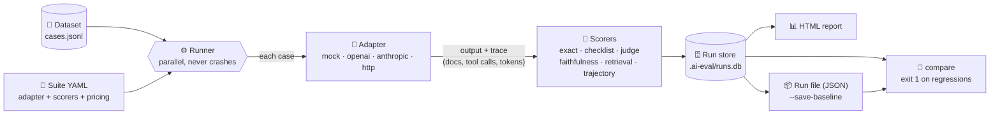
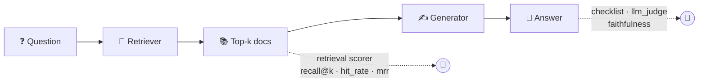
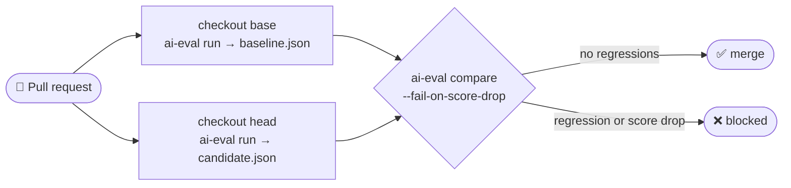

<div align="center">

# 🧪 ai-eval

### Test your LLM apps the way you test your code.

**Offline evaluation runner for LLM, RAG and agent systems** —
datasets in, scored runs out, regressions caught before they merge.

[](https://github.com/Dhillon001/ai-eval/actions/workflows/ci.yml)


[Quick start](#-quick-start) •
[How it works](#-how-it-works) •
[Adapters](#-adapters--what-youre-testing) •
[Scorers](#-scorers--how-its-graded) •
[RAG](#-evaluating-retrieval-vs-generation) •
[Agents](#-evaluating-agents) •
[CI gate](#-ci-regression-gate) •
[Cost & reliability](#-reliability-and-cost)

</div>

---

## 💡 Why ai-eval?

Changing a prompt, swapping a model, or re-chunking your documents can silently break answers
that used to work. Eyeballing a few chats doesn't catch that. **ai-eval** turns "does it still
work?" into a repeatable, versioned test run:

- 📋 **Write test cases once** as JSONL — questions, context, expected answers, expected tools.
- 🔌 **Point it at anything** — OpenAI, Anthropic, any OpenAI-compatible server, or your own HTTP service.
- 🎯 **Score it many ways** — exact match, checklists, LLM-as-judge, RAG faithfulness, retrieval metrics, agent trajectories.
- 🗂️ **Keep history** — every run is stored in a local SQLite database with an HTML report.
- 🚦 **Gate pull requests** — `compare` exits non-zero when a case regresses, so CI blocks the merge.
- 💸 **Know what it costs** — token usage and USD cost per run, with retries and a judge cache to keep bills down.

## ✨ Features at a glance

| | Feature | What you get |
|---|---|---|
| 🔌 | **4 adapters** | `mock`, `openai`, `anthropic`, `http` |
| 🎯 | **6 scorers** | `exact`, `checklist`, `llm_judge`, `faithfulness`, `retrieval`, `trajectory` |
| 🔍 | **RAG-aware** | Score the retriever (`recall@k`, `hit_rate`, `mrr`) separately from the generator |
| 🤖 | **Agent-aware** | Check *which tools were called, in what order, with which args* |
| 📊 | **Run history** | SQLite store, HTML reports, per-tag and per-scorer breakdowns |
| 🔁 | **Regression diff** | Pass→fail flips, score drops, improvements — across runs or machines |
| 🚦 | **CI-ready** | Ships with a GitHub Actions job that diffs `main` vs. your PR |
| ♻️ | **Resilient** | Exponential backoff + jitter on 429/5xx/timeouts |
| 💾 | **Judge cache** | Identical judge prompts are never paid for twice |
| 💸 | **Cost tracking** | Per-model price table, `cost_usd` on every run |
| ⚡ | **Parallel** | `-j 8` runs cases concurrently |

---

## 🚀 Quick start

```bash
git clone https://github.com/Dhillon001/ai-eval.git && cd ai-eval
python -m venv .venv && source .venv/bin/activate
pip install -e ".[openai,anthropic,dev]"
```

**1. Run with no API key** — the `mock` adapter is deterministic and free:

```bash
ai-eval run --suite configs/example_suite.yaml --adapter mock
```

```text
Run complete id=1942ec5b5f80
Pass rate: 3/3 (100.0%) | mean score: 1.000
Errors: 0 | latency p50/p95: 1/1 ms
Report: .ai-eval/reports/1942ec5b5f80.html
```

Open the HTML report to see every case's input, output, scores and errors.

**2. Run against a real model:**

```bash
# OpenAI (or any OpenAI-compatible API)
export OPENAI_API_KEY=sk-...
ai-eval run --suite configs/example_suite.yaml --adapter openai --model gpt-4o-mini

# Anthropic Claude — RAG suite, 8 cases in parallel
export ANTHROPIC_API_KEY=sk-ant-...
ai-eval run --suite configs/rag_suite.yaml -j 8
```

**3. Look at results and diff two runs:**

```bash
ai-eval list-runs                                   # history
ai-eval report --run-id <id>                        # (re)build the HTML report
ai-eval compare --baseline <id-a> --candidate <id-b> --fail-on-score-drop
```

---

## 🧭 How it works

Every run follows the same pipeline. A **suite** (YAML) ties a **dataset** of cases to an
**adapter** (the system under test) and a list of **scorers**:



1. **Load** — the suite YAML is read and every JSONL line becomes an `EvalCase`.
2. **Run** — the adapter sends each case to your system and returns a `RunResult`: the output
   text, latency, token counts and a free-form **trace** (retrieved doc ids, tool calls, etc.).
   Adapter crashes are recorded as failed cases; the run always finishes.
3. **Score** — each scorer turns `(case, result)` into a `ScoreResult` (`passed`, `score` in
   `[0, 1]`, `details`). A case passes when all its scorers pass.
4. **Store** — the summary (pass rate, mean score, latency p50/p95, tokens, cost, git SHA,
   config hash) and every outcome go into `.ai-eval/runs.db`, and an HTML report is written to
   `.ai-eval/reports/<run-id>.html`.
5. **Compare** — diff any two runs to find what got worse, what got better, and where.

---

## 📁 Project layout

```text
ai-eval/
├── configs/                 # 🧾 suite YAML files
│   ├── example_suite.yaml   #    chat + checklist (mock)
│   ├── rag_suite.yaml       #    RAG + faithfulness judge (anthropic)
│   ├── retrieval_suite.yaml #    retrieval metrics (mock)
│   ├── agent_suite.yaml     #    agent trajectories (mock)
│   └── http_example.yaml    #    your own service over HTTP
├── datasets/examples/       # 📄 JSONL test cases
├── src/ai_eval/
│   ├── cli.py               # ⌨️  `ai-eval` commands
│   ├── runner.py            # ⚙️  runs a suite end to end
│   ├── adapters/            # 🔌 systems under test
│   ├── scorers/             # 🎯 grading logic
│   ├── llm.py               # ♻️  provider calls + retries
│   ├── cache.py             # 💾 judge cache
│   ├── pricing.py           # 💸 price table + cost math
│   ├── store.py             # 🗄️  SQLite run history + JSON export
│   └── report.py            # 📊 HTML report + compare
├── tests/                   # ✅ pytest suite (fake clients, no network)
└── .ai-eval/                # 🗃️  runs.db, reports/, cache/ (gitignored)
```

---

## 🧾 Writing a suite

A suite is a small YAML file. Everything under `adapter:` (except `type`) is passed to the
adapter as options; each entry under `scorers:` builds one scorer.

```yaml
name: example-chat-v1
description: Starter suite for checklist scoring
dataset: datasets/examples/chat_v1.jsonl
adapter:
  type: mock                   # or openai / anthropic / http — override with --adapter
  template: "Support bot: We can help with {input}. Returns within 30 days."
scorers:
  - type: checklist
pricing:                       # optional — see "Cost tracking"
  my-finetune: {input_per_mtok: 0.30, output_per_mtok: 1.20}
```

## 📄 Writing test cases (JSONL)

One case per line:

```json
{"id": "refund-1", "input": "Can I get a refund?", "expected": "refund", "metadata": {"tags": ["support"]}, "checks": ["refund", "policy"]}
```

| field | type | used by |
|---|---|---|
| `id` | string, **required** | everything — results, reports and `compare` match on it |
| `input` | string, **required** | the adapter (`{input}` in templates) |
| `context` | string | adapters (`{context}`), `faithfulness` |
| `expected` | string | `exact`, `llm_judge` |
| `checks` | list of strings | `checklist` |
| `metadata.tags` | list of strings | per-tag pass rates in `compare` |
| `metadata.judge_criteria` | string | `llm_judge` |
| `metadata.expected_doc_ids` | list of doc ids | `retrieval` — see [Evaluating retrieval](#-evaluating-retrieval-vs-generation) |
| `metadata.expected_tools` | list of tool names or `{name, args}` | `trajectory` — see [Evaluating agents](#-evaluating-agents) |
| `metadata.mock_retrieved_ids` / `metadata.mock_tool_calls` | as above | `mock` adapter only: copied into the trace so suites run offline |

Other `metadata` keys are kept and stored with the run.

> [!TIP]
> Tag your cases (`"tags": ["policy", "multi-hop"]`). `compare` reports pass-rate deltas per
> tag, so a regression shows up as "multi-hop dropped 20%" instead of a list of case ids.

---

## 🔌 Adapters — what you're testing

The adapter is the system under test. Set it with `adapter.type` in the suite YAML, or
override it on the command line with `--adapter` / `--model`.

| type | what it calls | key options |
|---|---|---|
| `mock` | nothing — deterministic `echo:{input}` output for CI and local dev | `template` |
| `openai` | OpenAI Chat Completions, or any OpenAI-compatible server via `base_url` (`OPENAI_API_KEY`) | `model`, `base_url`, `system_prompt`, `temperature`, `max_tokens`, `max_retries` |
| `anthropic` | Anthropic Messages API (`ANTHROPIC_API_KEY`) | `model`, `system_prompt`, `temperature`, `max_tokens`, `max_retries` |
| `http` | any JSON-over-HTTP service — your own RAG app, agent, or gateway | `url`, `body_template`, `response_path`, `headers`, `timeout`, `method`, `trace_path` |

### 🌐 HTTP adapter — evaluate any service

Point the suite at your service, then describe how to build the request and where to find the
answer in the response ([`configs/http_example.yaml`](configs/http_example.yaml)):

```yaml
adapter:
  type: http
  url: http://localhost:8000/answer
  method: POST                  # default POST
  timeout: 30                   # seconds, default 30
  body_template:                # default {"input": "{input}", "context": "{context}"}
    question: "{input}"
    context: "{context}"
  response_path: data.answer    # dotted path; list indexes allowed (choices.0.message.content)
  headers:
    Authorization: "Bearer ${API_TOKEN}"
  trace_path:                   # optional: copy response fields into RunResult.trace
    retrieved_ids: data.retrieved_ids
    tool_calls: data.tool_calls
```

```bash
export API_TOKEN=...
ai-eval run --suite configs/http_example.yaml
```

For a case `{"input": "Can I get a refund?"}` this POSTs
`{"question": "Can I get a refund?", "context": null}`. Given the response
`{"data": {"answer": "Yes, within 30 days.", "retrieved_ids": ["policy-3"]}}`, it scores the
output `Yes, within 30 days.` and records `trace.retrieved_ids == ["policy-3"]`.

<details>
<summary><b>HTTP adapter details</b> — templates, headers, trace, errors</summary>

- **Templates**: a string that is exactly `"{input}"` or `"{context}"` is replaced by the raw value
  (missing context → `null`); placeholders inside longer strings are substituted as text (missing
  context → empty string). Nested objects and lists are rendered recursively.
- **Headers**: `${NAME}` is read from the environment. If a variable is unset the case fails
  with an error and no request is sent, so secrets never live in the YAML.
- **Output**: a string at `response_path` is used as-is; any other JSON value is serialized.
- **Trace**: `trace_path` is either a mapping of `trace key → dotted path` or one dotted path to
  an object whose keys are merged in. Unresolved paths are listed in `trace.trace_missing` rather
  than failing the case. The trace always records `url`, `method`, the rendered `request`, and
  `status_code`.
- **Errors**: timeouts, connection errors, non-2xx responses (with the first 200 chars of the
  body), invalid JSON, and a missing `response_path` are recorded as case errors; the run continues.

</details>

---

## 🎯 Scorers — how it's graded

| type | what it checks | needs |
|---|---|---|
| `exact` | normalized output == `expected` | `expected` |
| `checklist` | every string in `checks` appears in the output | `checks` |
| `llm_judge` | an LLM grades the output against `metadata.judge_criteria` / `expected` (`provider: openai\|anthropic`) | API key |
| `faithfulness` | an LLM checks every claim is supported by `context` (RAG); skips cases without context | `context`, API key |
| `retrieval` | ranked `trace.retrieved_ids` vs. `metadata.expected_doc_ids` — `recall@k`, `hit_rate`, `mrr` | trace + metadata |
| `trajectory` | agent `trace.tool_calls` vs. `metadata.expected_tools` — `exact_order`, `any_order`, `subset` | trace + metadata |

Stack as many as you like — a case passes only if **every** scorer passes, and each scorer's
mean is tracked separately so you can see *which* dimension moved.

> [!NOTE]
> The judge scorers run at temperature 0, ask for strict JSON
> (`{"pass", "score", "reason"}`), and fall back to `score >= pass_threshold` (default `0.7`)
> when the judge omits `pass`. Unparseable output is a failed verdict, never a crash.

---

## 🔍 Evaluating retrieval vs. generation

A RAG system can fail in two places: the **retriever** didn't fetch the right documents, or the
**generator** had the right documents and still answered badly. Score them separately so a
regression points at the stage that caused it.



| stage | question | scorers | needs |
|---|---|---|---|
| retrieval | did the right docs come back, ranked high enough? | `retrieval` | `trace.retrieved_ids`, `metadata.expected_doc_ids` |
| generation | is the answer correct and grounded in the context? | `exact`, `checklist`, `llm_judge`, `faithfulness` | `expected` / `checks` / `context` |

**Retrieval cases** list the relevant doc ids per case; the system under test reports the ids
it retrieved, in rank order:

```json
{"id": "ret-final-sale", "input": "Can I return a final-sale jacket?",
 "metadata": {"expected_doc_ids": ["policy-returns", "policy-final-sale"]}}
```

The `http` adapter fills the trace from your service's response with `trace_path`
(e.g. `trace_path: {retrieved_ids: retrieval.doc_ids}`). Offline, the `mock` adapter copies
`metadata.mock_retrieved_ids` into `trace.retrieved_ids`, which is how
[`configs/retrieval_suite.yaml`](configs/retrieval_suite.yaml) runs without a service:

```yaml
scorers:
  - type: retrieval
    metric: recall@3       # every expected doc must appear in the top 3
  - type: retrieval
    metric: hit_rate
    k: 1                   # is the top-ranked doc relevant? (reported, not gated)
    threshold: 0.0
  - type: retrieval
    metric: mrr
    threshold: 0.5         # first relevant doc ranked 1st or 2nd
```

```bash
ai-eval run --suite configs/retrieval_suite.yaml
```

| metric | meaning | default threshold |
|---|---|---|
| `recall@k` | fraction of expected ids found in the top k | `1.0` |
| `hit_rate` | `1.0` if any expected id is in the top k, else `0.0` | `1.0` |
| `mrr` | `1 / rank` of the first expected id in the top k, `0.0` if none | `0.5` |

<details>
<summary><b>Retrieval scorer details</b> — k, naming, skips, reading results together</summary>

Metrics are computed over the top `k` retrieved ids (no `k` = the whole list; duplicate ids
are counted once). `k` can be set as an option or in the metric name (`recall@5`, `hit@1`).
Each scorer is reported as `retrieval:<metric>@<k>`, so several can sit in one suite. Case
details include `found`, `missing` and `first_relevant_rank`. Cases without `expected_doc_ids`
or without `retrieved_ids` in the trace are skipped (pass, `details.skipped`); a non-list value
is a failure. Override the field names with `trace_key` / `expected_key`.

**Both stages in one suite**: give cases `context` + `checks` and `expected_doc_ids`, then list
`retrieval` next to `checklist` / `faithfulness`. Reading the per-scorer results together:

| retrieval | generation | diagnosis |
|---|---|---|
| ❌ | ❌ | Fix the retriever first; the generator never saw the answer. |
| ✅ | ❌ | The problem is the prompt or the model. |
| ❌ | ✅ | The answer came from the model's own knowledge or an unlabeled doc — check `expected_doc_ids` and faithfulness. |

`compare` reports per-scorer mean deltas, so a PR that changes chunking or embeddings shows up
as a `retrieval:*` drop rather than an unexplained answer-quality regression.

</details>

---

## 🤖 Evaluating agents

An agent can reach the right answer by the wrong path — skipping a lookup, calling a refund
tool twice, or guessing an argument. The `trajectory` scorer checks the tool calls the agent
made against the ones each case expects, alongside the usual output scorers.

**Agent cases** list the expected calls in `metadata.expected_tools`. Each entry is a bare tool
name (`"lookup_order"`) or `{name, args}`; `args` only matter when the scorer sets
`match_args: true`:

```json
{"id": "agent-order-status", "input": "Where is my order A1001?",
 "metadata": {"expected_tools": [
   {"name": "lookup_order", "args": {"order_id": "A1001"}},
   {"name": "get_shipping_status", "args": {"tracking_id": "1Z999"}}]}}
```

The system under test reports what it actually called as `trace.tool_calls`, in call order.
Entries may be `{name, args}`, `{name, arguments}` (arguments may be a JSON string, as OpenAI
returns them), OpenAI-style `{"function": {...}}`, or bare names. With the `http` adapter, map it
from your service's response (`trace_path: {tool_calls: steps.tool_calls}`). Offline, the `mock`
adapter copies `metadata.mock_tool_calls` into `trace.tool_calls`, which is how
[`configs/agent_suite.yaml`](configs/agent_suite.yaml) runs without a service:

```yaml
scorers:
  - type: trajectory
    mode: subset           # every expected call must happen, with the expected args ...
    match_args: true       # ... extra calls (e.g. a policy check) are allowed
  - type: trajectory
    mode: any_order        # same set of calls, order ignored, extras penalized
    threshold: 0.5
  - type: trajectory
    mode: exact_order      # strict sequence match, args included - reported, not gated
    match_args: true
    threshold: 0.0
```

```bash
ai-eval run --suite configs/agent_suite.yaml
```

The score is the fraction of calls matched, in `[0, 1]`; a case passes when it reaches
`threshold` (default `1.0`).

| mode | order | extra calls | score |
|---|---|---|---|
| `exact_order` (default) | must match | penalized | longest in-order match / max(expected, actual) |
| `any_order` | ignored | penalized | matched / max(expected, actual) |
| `subset` | ignored | allowed | matched / expected |

<details>
<summary><b>Trajectory scorer details</b> — arg matching, details, skips</summary>

- **Arg matching** (`match_args: true`): an expected entry with `args` matches a call whose args
  contain those key/value pairs — extra actual args (say, a `carrier` the agent added) are fine.
  Expected entries without `args` match on name alone. Repeated tools are matched one-to-one,
  so expecting `get_weather` for Paris and Tokyo needs two calls.
- **Details**: each result lists `matched`, `missing`, `extra` (reported but not penalized in
  `subset` mode) and `arg_mismatches` — expected tools that were called, but with the wrong
  args.
- **Skips and errors**: cases without `expected_tools` or without `tool_calls` in the trace are
  skipped (pass, `details.skipped`). An explicit empty `expected_tools: []` means "no tools
  should be called", so any call fails it in the strict modes. Malformed entries (no name,
  non-object args) fail the case. Override the field names with `trace_key` / `expected_key`.

</details>

Each scorer is reported as `trajectory:<mode>`, so one suite can gate on a lenient mode and
just report a strict one, as above. Pair it with `checklist` or `llm_judge` on the final answer
to tell **"right tools, wrong answer"** from **"right answer, wrong tools"**.

---

## 🔁 Comparing runs

`compare` diffs two runs and reports:

| key | meaning |
|---|---|
| `regressions` | cases that flipped **pass → fail** |
| `score_drops` | cases that didn't flip but whose mean score fell by more than `0.1` |
| `improvements` | cases that flipped **fail → pass** |
| missing / new cases | ids present in only one of the runs |
| per-scorer deltas | change in each scorer's mean score |
| per-tag deltas | change in pass rate for each `metadata.tags` value |

It **exits 1 on regressions** (and on score drops with `--fail-on-score-drop`), so it can gate CI.

Runs can also be compared **across machines**: `run --save-baseline PATH` exports a run
(summary, per-case outcomes, cases) as JSON, and `compare` accepts `--baseline-file` /
`--candidate-file` in place of run ids (you can mix a file with a local run id).

```bash
ai-eval run --suite configs/example_suite.yaml --adapter mock --save-baseline baseline.json
# ...later, or on another machine...
ai-eval run --suite configs/example_suite.yaml --adapter mock --save-baseline candidate.json
ai-eval compare --baseline-file baseline.json --candidate-file candidate.json --fail-on-score-drop
```

---

## 🚦 CI regression gate

`.github/workflows/ci.yml` runs three jobs:

| job | when | what it does |
|---|---|---|
| `test` | pushes to `main` & PRs | `pytest` on Python 3.10, 3.11 and 3.12 |
| `eval-gate` | pushes to `main` & PRs | mock suite must pass 100%; HTML report uploaded as an artifact |
| `regression-gate` | pull requests | evaluates the base commit **and** the PR head, then `compare --fail-on-score-drop` |



<details>
<summary><b>The regression-gate workflow</b></summary>

```yaml
  regression-gate:
    if: github.event_name == 'pull_request'
    runs-on: ubuntu-latest
    steps:
      - uses: actions/checkout@v5
        with:
          ref: ${{ github.event.pull_request.base.sha }}
          path: base
      - uses: actions/checkout@v5
        with:
          ref: ${{ github.event.pull_request.head.sha }}
          path: head
      - uses: actions/setup-python@v6
        with:
          python-version: "3.12"
      - name: Eval on base
        working-directory: base
        run: |
          pip install -e ".[dev]"
          ai-eval run --suite configs/example_suite.yaml --adapter mock \
            --save-baseline "$RUNNER_TEMP/baseline.json"
      - name: Eval on PR head
        working-directory: head
        run: |
          pip install -e ".[dev]"
          ai-eval run --suite configs/example_suite.yaml --adapter mock \
            --save-baseline "$RUNNER_TEMP/candidate.json"
      - name: Compare
        working-directory: head
        run: |
          ai-eval compare --fail-on-score-drop \
            --baseline-file "$RUNNER_TEMP/baseline.json" \
            --candidate-file "$RUNNER_TEMP/candidate.json"
```

</details>

- The mock adapter keeps the gate **free and deterministic**. To gate on a real model, swap in
  `--adapter openai --model ...` (or a suite using `anthropic`) and expose the API key as a
  repository secret via `env:`; expect some run-to-run noise from sampling.
- Each checkout installs its own copy of the package, so a PR that changes scorers or
  adapters is evaluated with its own code while the base uses the base code.
- Both run files are uploaded as the `regression-gate-runs` artifact for inspection.

---

## 💸 Reliability and cost

Real API runs are slow, flaky and cost money. ai-eval handles all three.

### ♻️ Retries with backoff

OpenAI and Anthropic calls (the `openai`/`anthropic` adapters **and** LLM judges) are retried on transient failures —
HTTP `408`, `429`, any `5xx`, timeouts and connection errors — with exponential backoff and
jitter. A server-sent `Retry-After` header is honoured. Non-transient errors (bad key,
bad request) fail immediately.

| setting | default | where |
|---|---|---|
| `max_retries` | `3` (`0` disables) | `adapter:` options, or on an `llm_judge` / `faithfulness` scorer |
| backoff | `0.5s × 2^attempt`, randomized to 50–100%, capped at `20s` | built in |

The SDKs' own retries are switched off so attempts are never multiplied, and the number of
retries used is recorded in each case's trace.

### 💾 Judge cache

Judge calls run at temperature 0, so the same prompt gives the same verdict. ai-eval caches
each verdict on disk under `.ai-eval/cache/`, keyed by a SHA-256 of
`(provider, model, system prompt, prompt)`. Re-running a suite over unchanged outputs costs
**nothing** for judging.

```bash
ai-eval run --suite configs/rag_suite.yaml              # judge results cached
ai-eval run --suite configs/rag_suite.yaml --no-cache   # bypass: no reads, no writes
```

Turn it off for a single scorer with `cache: false`. Writes are atomic, so parallel runs can
share the cache, and the CLI summary shows `judge cache hits: N`.

### 💵 Cost tracking

Every run records what it cost in USD, split into the **system under test** and the
**LLM judge**, using a per-model price table (USD per million tokens):

| model | input / 1M tokens | output / 1M tokens |
|---|---|---|
| `gpt-4o-mini` | $0.15 | $0.60 |
| `gpt-4o` | $2.50 | $10.00 |
| `claude-haiku-5-5` | $0.10 ($0.50 above 100K-token prompts) | $0.50 ($2.50 above 100K-token prompts) |

> [!IMPORTANT]
> Built-in prices are a convenience snapshot and can drift from what providers charge.
> Check them against your provider's pricing page, and override or add models per suite:

```yaml
pricing:
  my-finetune:
    input_per_mtok: 0.30
    output_per_mtok: 1.20
  gpt-4o:                       # override a built-in price
    input_per_mtok: 2.00
    output_per_mtok: 8.00
  big-context-model:            # optional long-context tier: prompts over the threshold
    input_per_mtok: 1.00        # are billed entirely at the long_* rates
    output_per_mtok: 4.00
    long_context_threshold: 200000
    long_input_per_mtok: 2.00
    long_output_per_mtok: 8.00
```

How it's calculated:

- **Per call**: `(prompt_tokens × input rate + completion_tokens × output rate) / 1,000,000`.
- **Dated snapshots** match their base model: `gpt-4o-mini-2024-07-18` uses `gpt-4o-mini`.
- **Cached judge verdicts cost $0** — you only pay for judging the first time.
- Models with no price are listed in `unpriced_models` (and printed as a warning) instead of being guessed.

Run metadata gains `cost_usd`, `cost_usd_system`, `cost_usd_judge` and `unpriced_models`, and the
CLI prints:

```text
Cost: $0.0123 (system $0.0081 + judge $0.0042)
```

---

## ⌨️ CLI reference

| command | what it does | key options |
|---|---|---|
| `ai-eval run` | run a suite, store results, write an HTML report | `--suite`, `--adapter`, `--model`, `-j/--concurrency`, `--min-pass-rate`, `--save-baseline`, `--no-cache` |
| `ai-eval list-runs` | table of recent runs | `--limit` |
| `ai-eval report` | (re)build the HTML report for a run | `--run-id` |
| `ai-eval compare` | diff two runs; exit 1 on regressions | `--baseline` / `--baseline-file`, `--candidate` / `--candidate-file`, `--fail-on-score-drop` |

`run` exits **1** when the pass rate is below `--min-pass-rate`, which makes it a one-line CI check:

```bash
ai-eval run --suite configs/example_suite.yaml --adapter mock --min-pass-rate 1.0
```

### What gets recorded per run

| field | example |
|---|---|
| pass rate / mean score | `6/6 (100.0%)`, `0.935` |
| errors | number of cases whose adapter call failed |
| latency | `latency_ms_p50`, `latency_ms_p95` |
| tokens | `prompt_tokens`, `completion_tokens` (when the adapter reports them) |
| cost | `cost_usd`, `cost_usd_system`, `cost_usd_judge`, `unpriced_models` |
| judge cache | `judge_cache_hits` |
| provenance | `git_sha`, `config_hash`, adapter, model, suite path, concurrency |

---

## 🧩 Extending

| to add… | implement | then register in |
|---|---|---|
| a new system under test | `SystemAdapter.run(case) -> RunResult` in `src/ai_eval/adapters/` | `build_adapter` in `adapters/__init__.py` |
| a new grading rule | `Scorer.score(case, run) -> ScoreResult` in `src/ai_eval/scorers/` | `build_scorer` in `scorers/__init__.py` |
| RAG / agent signals | put them in `RunResult.trace` (white-box traces) | read them from your scorer |

## 🛠️ Development

```bash
pip install -e ".[dev]"
python -m pytest -q          # unit tests use fake SDK clients and httpx.MockTransport — no network, no keys
ai-eval run --suite configs/example_suite.yaml --adapter mock --min-pass-rate 1.0
```

## 🗺️ Roadmap

v0.2 is being built one shippable step at a time — see [ROADMAP.md](ROADMAP.md). Coming up next:
richer HTML reports (summary cards, per-tag tables, side-by-side run diffs) and a `bench`
command for comparing several models on one suite.

<div align="center">
<sub>Built with ❤️ by <a href="https://github.com/Dhillon001">Harsharandeep Dhillon</a></sub>
</div>
