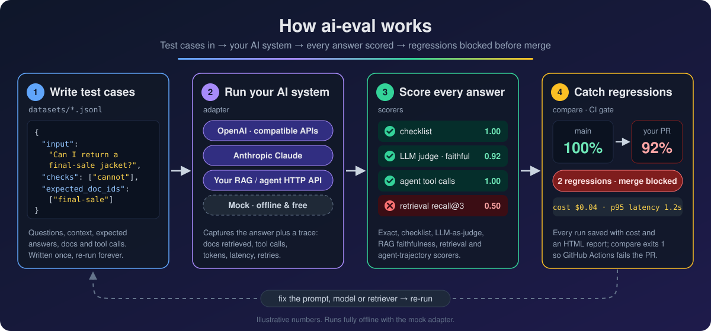
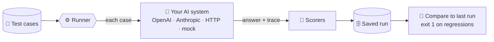
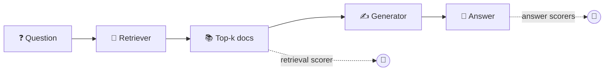
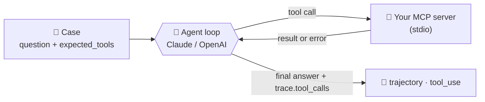

<div align="center">

# 🧪 ai-eval

### Test your LLM apps the way you test your code.

**Offline evaluation runner for LLM, RAG and agent systems** —
test cases in, scored runs out, regressions caught before they merge.

[](https://github.com/Dhillon001/ai-eval/actions/workflows/ci.yml)


<br/>



</div>

---

## 💡 The problem

Changing a prompt, swapping a model, or adding documents to a knowledge base can **silently break answers that used to work**. Eyeballing a few chats won't catch it.

**ai-eval** turns "does it still work?" into a repeatable test: write the questions and expected answers once, run them after every change, and block the change if something got worse.

---

## 🧭 How it works



1. **Write test cases** — a question plus what a good answer looks like.
2. **Run** them through your AI system.
3. **Score** every answer.
4. **Compare** with the previous run and flag anything that got worse.

---

## 🔍 RAG can fail in two places

A RAG system first **retrieves** documents, then **generates** an answer from them. Either step can break, so ai-eval scores them separately and a failure points at the step that caused it.



| step | what can go wrong | how it's scored |
|---|---|---|
| Retrieval | It fetched the wrong documents | `retrieval` |
| Generation | It had the right documents but still answered badly | `checklist`, `llm_judge`, `faithfulness` |

---

## 🎯 Scorers

| scorer | what it checks | example |
|---|---|---|
| `exact` | the answer equals the expected text | expected "30 days" |
| `checklist` | the answer contains required words | must mention "refund" and "30 days" |
| `llm_judge` | another LLM grades the answer | "is this a correct summary of the policy?" |
| `faithfulness` | every claim is backed by the retrieved documents | no made-up facts |
| `retrieval` | the right documents came back, ranked high | see below |
| `trajectory` | an agent called the right tools | looked up the order before refunding |
| `tool_use` | an agent used tools accurately and efficiently (precision, recall, invalid args, extra calls) | no malformed or wasted calls when checking stock |

A case passes only if **every** scorer passes.

**Retrieval metrics:**

| metric | meaning |
|---|---|
| `recall@k` | what fraction of the right documents are in the top k results |
| `hit_rate` | is at least one right document in the top k? |
| `mrr` | how high the first right document is ranked (1st = 1.0, 2nd = 0.5, 3rd = 0.33) |

---

## 🧪 Example: catching a bad change

A support bot answers questions from five documents. The team re-chunks them, and ai-eval compares the runs before and after:

| question | right documents | before | after the change |
|---|---|---|---|
| "How long do I have to return an item?" | `policy-returns` | ✅ found | ✅ found |
| "Can I return a final-sale jacket?" | `policy-returns`, `policy-final-sale` | ✅ both found | ❌ `policy-returns` missing |
| "Do you ship to Canada?" | `faq-shipping-intl` | ✅ found | ❌ not found |
| "Where is my order A1001?" | agent calls the right tools | ✅ | ✅ |

**Result:** pass rate drops from 4/4 to 2/4. The answer-text checks did not change, but both retrieval scores dropped, so the problem is the **retriever**, not the prompt or the model. `compare` exits with code 1 and CI blocks the merge.

---

## 🚦 CI regression gate

On every pull request, GitHub Actions runs the tests on the main branch and on the PR, compares the two, and blocks the merge if anything regressed.


---

## 🚀 Quick start

No API key needed. The `mock` adapter is free and gives the same result every time.

```bash
git clone https://github.com/Dhillon001/ai-eval.git && cd ai-eval
python -m venv .venv && source .venv/bin/activate
pip install -e ".[dev]"

# run the example, then run the "bad change" version and compare
ai-eval run --suite configs/worked_example.yaml --adapter mock --save-baseline baseline.json
ai-eval run --suite configs/worked_example_regressed.yaml --adapter mock --save-baseline candidate.json
ai-eval compare --baseline-file baseline.json --candidate-file candidate.json --fail-on-score-drop
```

Every run also writes an HTML report to `.ai-eval/reports/`.

---

## 🔧 Evaluating MCP servers

An [MCP](https://modelcontextprotocol.io) server is only as good as an agent's ability to use it. The `mcp` adapter launches your stdio server, lets a model (Claude, or any OpenAI function-calling model) answer each test case with the server's tools, and records every call so you can score **which tools were called, with what arguments, and how many calls it took**.



The repo ships a toy parts-inventory server, [`examples/mcp_inventory_server.py`](examples/mcp_inventory_server.py), with five tools (`list_warehouses`, `search_parts`, `get_part`, `check_stock`, `reserve_part`) and an 8-case suite that covers lookups, multi-step questions, reservations, tool errors (unknown SKU, not enough stock) and a question that needs no tools at all.

**1. Write cases with the calls you expect.** Each case in [`datasets/examples/mcp_inventory_v1.jsonl`](datasets/examples/mcp_inventory_v1.jsonl) lists `expected_tools` — tool names, or `{name, args}` when the arguments matter:

```json
{"id": "mcp-reserve",
 "input": "Reserve 2 BRK-001 brake pad sets from the Seattle warehouse.",
 "expected": "Reserved 2 BRK-001 in Seattle (reservation R-0001).",
 "metadata": {"expected_tools": [
   {"name": "check_stock",  "args": {"sku": "BRK-001"}},
   {"name": "reserve_part", "args": {"sku": "BRK-001", "quantity": 2, "warehouse": "SEA"}}]}}
```

**2. Point the suite at your server.** [`configs/mcp_suite.yaml`](configs/mcp_suite.yaml):

```yaml
adapter:
  type: mcp
  provider: anthropic          # or openai
  model: claude-haiku-5-5
  max_steps: 6                 # model turns before the case fails with stop_reason=max_steps
  allowed_tools: [list_warehouses, search_parts, get_part, check_stock, reserve_part]
  denied_tools: []             # globs ok, e.g. ["delete_*"]; denylist wins over allowlist
  tool_timeout: 10             # seconds per tool call
  server:
    command: python            # resolves to the running interpreter
    args: [examples/mcp_inventory_server.py]
scorers:
  - type: trajectory           # every expected call happened, with the expected args
    mode: subset
    match_args: true
  - type: tool_use             # precision, recall, invalid-arg rate, efficiency
    min_recall: 1.0
    max_invalid_arg_rate: 0.0
    min_efficiency: 0.5        # at most twice the optimal number of calls
```

Tools outside the allowlist (or on the denylist) are never offered to the model; if it calls one anyway, the call is not run and is recorded with `blocked: true` and an error.

**3. Run it.** Offline first — the `mock` adapter replays each case's `metadata.mock_tool_calls`, so you can check the suite and scorers without a key:

```bash
ai-eval run --suite configs/mcp_suite.yaml --adapter mock
# Pass rate: 8/8 (100.0%) | mean score: 0.984
```

The mean is below 1.0 because one replayed trajectory calls `list_warehouses` before `check_stock`: 2 calls where 1 was optimal, so `tool_use` efficiency is 0.5 — still within `min_efficiency`, but visible in the report.

Then against a real model and the real server:

```bash
pip install -e ".[mcp,anthropic]"          # or ".[mcp,openai]" with provider: openai
export ANTHROPIC_API_KEY=...
ai-eval run --suite configs/mcp_suite.yaml --save-baseline mcp-baseline.json
```

**4. Read the results.** Every outcome stores the full trajectory in `trace.tool_calls` (`name`, `args`, `result`, `error`, `step`), plus `steps` and `stop_reason`; the HTML report shows it per case. The `tool_use` scorer reports:

| metric | meaning |
|---|---|
| `precision` | share of calls made that matched an expected call — extra, repeated or wrong-tool calls lower it |
| `recall` | expected calls that actually happened (with matching args) |
| `invalid_arg_rate` | share of calls rejected for bad arguments (validation errors, optional JSON-schema check) |
| `efficiency` | optimal calls / calls made (optimal = `metadata.optimal_steps` or the number of expected calls) |

Change a tool description, rename a parameter or swap the model, run again, and `ai-eval compare --baseline-file mcp-baseline.json --candidate-file candidate.json` shows exactly which cases started calling the wrong tools.

---

## 📚 More

Adapters, cost tracking, retries, the judge cache, benchmarks and every command are in the **[full reference](docs/REFERENCE.md)**.

<div align="center">
<sub>Built with ❤️ by <a href="https://github.com/Dhillon001">Harsharandeep Dhillon</a></sub>
</div>
